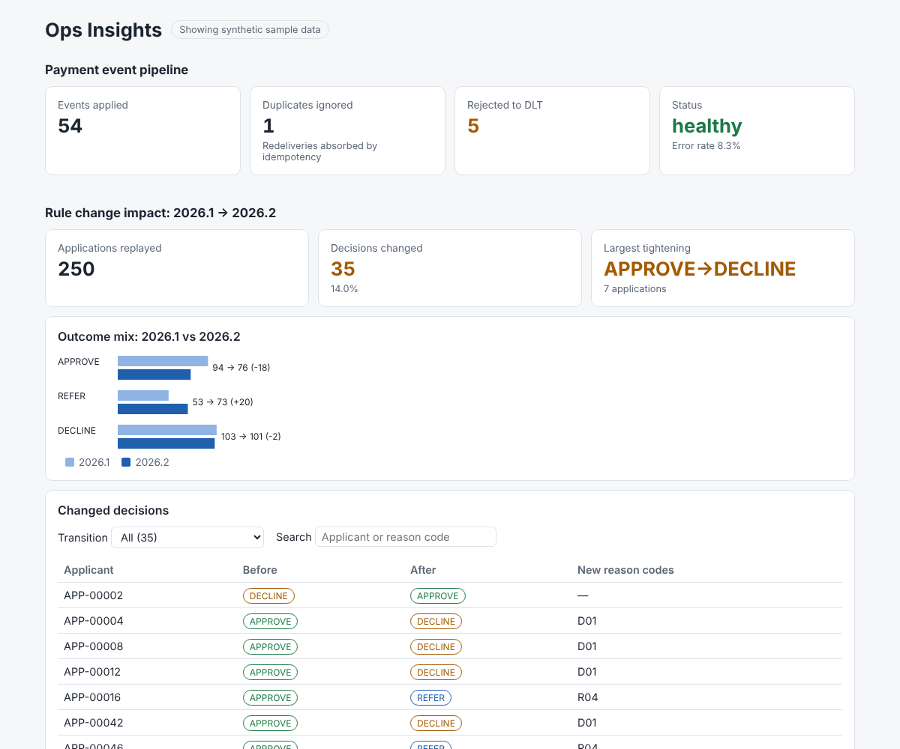

# ops-insights-dashboard

React 18 + TypeScript front end for two portfolio services. It shows health counters from `payment-event-pipeline` and the rule-change impact report from `credit-decision-rules-engine`.

> **Portfolio project.** Independently written. Every number on screen comes from synthetic sample data generated by the companion repositories.



## What it shows

- **Pipeline health:** events applied, duplicates absorbed by idempotency, events rejected to the dead-letter topic, and a healthy/degraded status based on error rate.
- **Rule change impact:** applications replayed, decisions changed, the largest tightening (for example APPROVE→DECLINE), the baseline vs candidate outcome mix, and a filterable table of every changed decision with its new reason codes.

The bundled samples are real output from the other repos. `pipeline-stats.json` is the result of running the pipeline's core handler over its sample events, and `impact-report.json` is the rules engine's 2026.1 → 2026.2 impact report on its 250-application synthetic portfolio.

## Tech stack

React 18 · TypeScript (strict) · Vite 5 · Vitest + Testing Library · plain SVG charts (no chart library) · Docker (nginx) · GitHub Actions

## Run locally

```bash
npm ci
npm run dev          # http://localhost:5173, uses synthetic samples
```

To read from the live services, copy `.env.example` to `.env` and start the two back ends. The services must allow CORS from the dashboard's origin, or run behind the same reverse proxy. If a service is down, the dashboard falls back to the samples and labels the page accordingly.

## Tests

```bash
npm test
```

There are 11 tests. They cover the data helpers (percentages, outcome deltas, riskiest transition, filtering, health thresholds), the API loaders (sample fallback, live call, error fallback) and component behaviour (rendering and filtering the table).

## Design notes

- All data access goes through `lib/api.ts` with an injectable `fetch`, so components never call the network directly and tests need no mocking library.
- Light and dark themes follow `prefers-color-scheme`. The layout works down to phone width with no horizontal scroll.

## Limitations and next steps

- No authentication. In front of real services this would sit behind SSO.
- Add polling or server-sent events for live pipeline counters.
- Add a candidate rule-set picker driven by `/api/rulesets`.

## License

MIT
